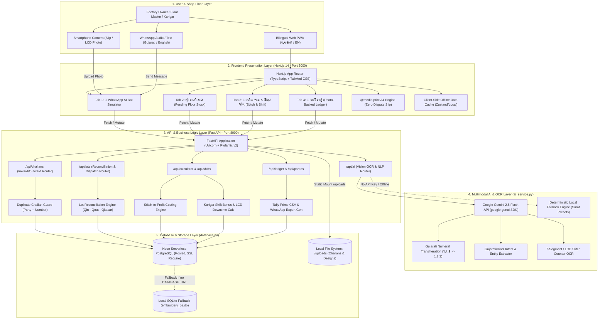
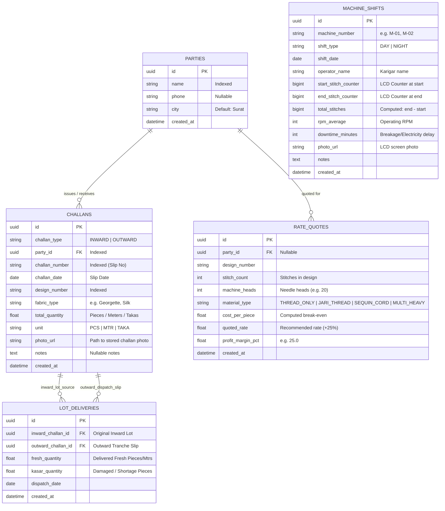
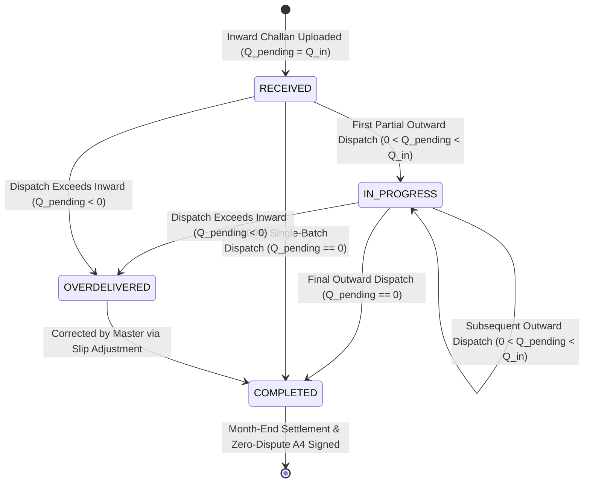
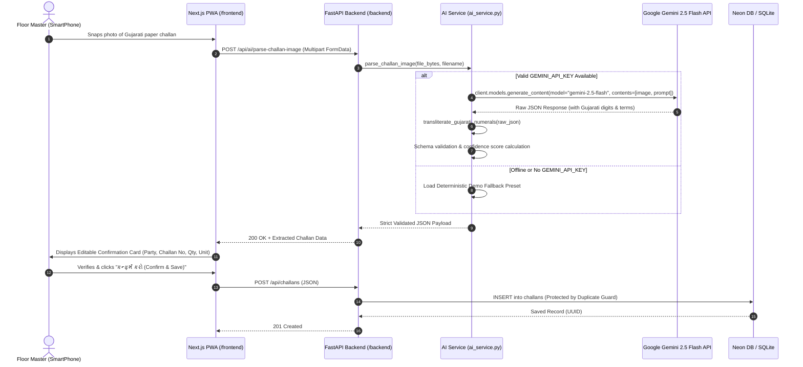
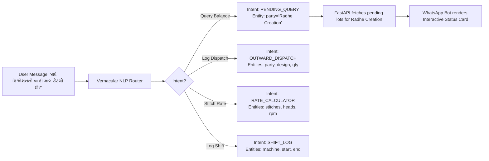
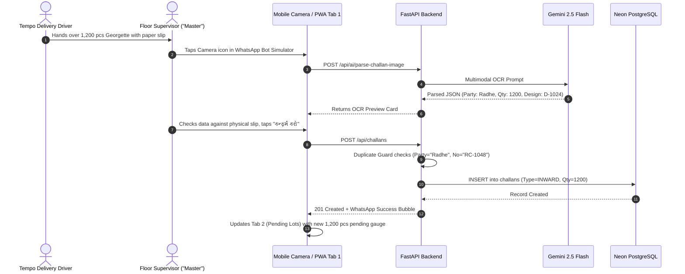
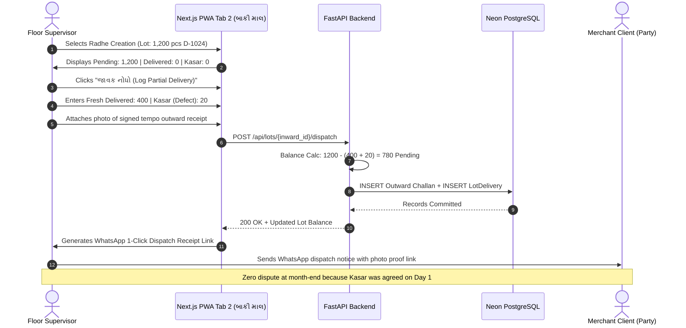
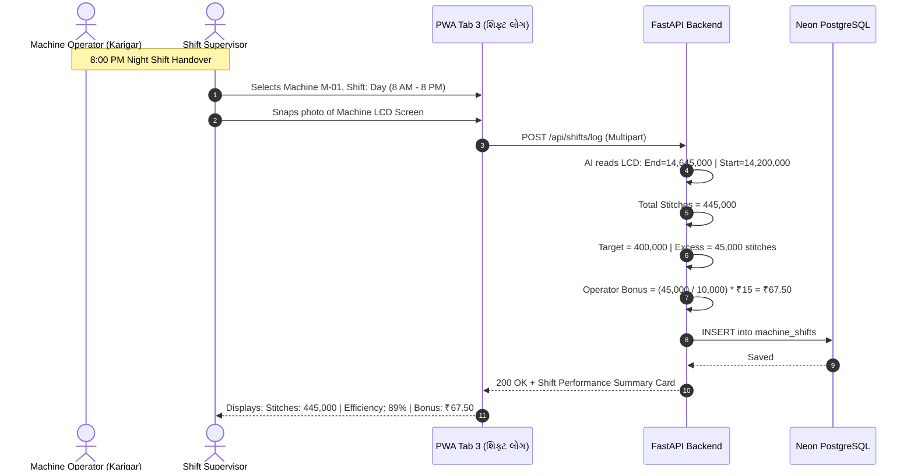
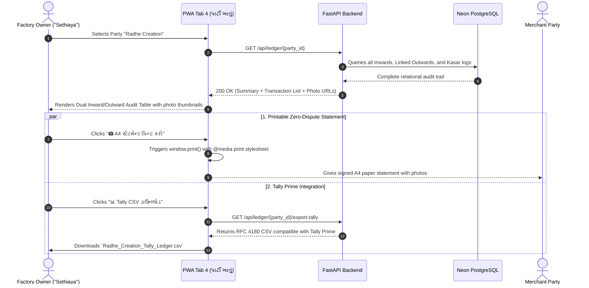

# ChallanAI (EmbroideryOS) - System Architecture & End-to-End Flow Blueprint

> **File:** `ARCHITECTURE_AND_FLOW.md`  
> **System:** ChallanAI (EmbroideryOS) - Job-Work & Lot Reconciliation Operating System  
> **Target Clusters:** Gujarat Textile Hubs (Surat, Ahmedabad, Jetpur)  
> **Languages Supported:** Gujarati (`ગુજરાતી`) & English (`EN`)  
> **Status:** Single Source of Truth (SSOT) Architecture Blueprint

---

## TABLE OF CONTENTS
1. [SECTION 1: High-Level System Architecture Diagram](#section-1-high-level-system-architecture-diagram)
   - 1.1 Five-Layer Architectural Stack
   - 1.2 Mermaid System Topology Diagram
   - 1.3 ASCII System Architecture Map
   - 1.4 Detailed Layer Responsibilities & Protocols
2. [SECTION 2: Complete Repository Folder & File Tree](#section-2-complete-repository-folder--file-tree)
   - 2.1 Repository Directory Structure
   - 2.2 Deep File Responsibility & Boundary Matrix
3. [SECTION 3: Database Entity-Relationship (ER) Schema & Mathematical Models](#section-3-database-entity-relationship-er-schema--mathematical-models)
   - 3.1 Mermaid Entity-Relationship (ER) Diagram
   - 3.2 SQLModel Table Definitions & Field Constraints
   - 3.3 Core Mathematical Reconciliation & Financial Formulas
   - 3.4 Lot Balance State Machine & Lifecycle Transitions
4. [SECTION 4: Multimodal AI & Gujarati Vernacular Parsing Pipeline](#section-4-multimodal-ai--gujarati-vernacular-parsing-pipeline)
   - 4.1 Gemini 2.5 Flash Vision OCR Architecture (`google-genai` SDK)
   - 4.2 Gujarati Numeral Transliteration Engine
   - 4.3 Multimodal Prompt Blueprint & Strict JSON Schema
   - 4.4 Vernacular Voice/Text Intent Parsing Pipeline
   - 4.5 Machine LCD Stitch Counter Vision Parser
   - 4.6 Deterministic Offline & Local Demo Fallback Engine
5. [SECTION 5: End-to-End User & Business Logic Flows](#section-5-end-to-end-user--business-logic-flows)
   - 5.1 Flow A: Physical Inward Challan Capture & Reconciliation
   - 5.2 Flow B: Tranche Partial Outward Dispatch & Kasar Dispute Prevention
   - 5.3 Flow C: Machine LCD Shift Stitch Tracking & Operator Bonus Calculation
   - 5.4 Flow D: Party Ledger, Zero-Dispute A4 Settlement & Tally Prime Export
6. [SECTION 6: API Endpoint Specification, Request/Response Contracts & Error Handling](#section-6-api-endpoint-specification-requestresponse-contracts--error-handling)
   - 6.1 REST Endpoint Master Table
   - 6.2 Typed Request & Response JSON Contracts
   - 6.3 Validation Guards, Error Matrices & HTTP Status Codes

---

# SECTION 1: HIGH-LEVEL SYSTEM ARCHITECTURE DIAGRAM

ChallanAI (EmbroideryOS) is architected specifically for the rough, fast-paced environment of textile embroidery job-work factories. Floor operators ("Karigars") and supervisors ("Masters") need zero-friction capture (camera photos, WhatsApp voice/text in Gujarati), while factory owners ("Sethiayas") need mathematical precision to eliminate month-end "Kasar" (shortage/damage deduction) disputes with merchant clients ("Parties").

### 1.1 Five-Layer Architectural Stack

```
┌──────────────────────────────────────────────────────────────────────────────┐
│ 1. USER & SHOP-FLOOR LAYER                                                    │
│    • Factory Owner / Floor Supervisor ("Master") / Machine Operator ("Karigar")│
│    • Inputs: Smartphone Camera, WhatsApp Audio/Text, Web PWA (ગુજરાતી / EN)    │
└──────────────────────────────────────┬───────────────────────────────────────┘
                                       │ HTTPS / WebRTC / Media
┌──────────────────────────────────────▼───────────────────────────────────────┐
│ 2. FRONTEND LAYER (Next.js 14 App Router, Port 3000)                         │
│    • Mobile-First PWA (360px - 430px optimized, desktop tablet compatible)   │
│    • 4 Tabs: 💬 WhatsApp Bot | 📦 Pending Lots | 🧮 Stitch Calc | 📄 Ledger   │
│    • Bilingual Engine (Instant Gujarati <-> English switch)                  │
│    • Print-Ready A4 PDF Engine (@media print) + Client-Side Offline Cache    │
└──────────────────────────────────────┬───────────────────────────────────────┘
                                       │ REST API (JSON / Multipart Form-Data)
┌──────────────────────────────────────▼───────────────────────────────────────┐
│ 3. API & BUSINESS LOGIC LAYER (FastAPI + SQLModel, Port 8000)                │
│    • Duplicate Challan Guard & Cross-Party Collision Check                   │
│    • Lot Reconciliation Engine (Live Balances, Kasar Shortage Allocator)     │
│    • Stitch-to-Profit Costing Engine (RPM, Heads, Thread, Margin)           │
│    • Karigar Shift Bonus & Machine Efficiency Downtime Analyzer              │
│    • Tally Prime CSV & WhatsApp Udhari Reconciliation Generator              │
└──────────────────┬───────────────────────────────────────────┬───────────────┘
                   │ gRPC / REST (google-genai)                │ SQL (psycopg3)
┌──────────────────▼──────────────────────────┐ ┌──────────────▼───────────────┐
│ 4. MULTIMODAL AI & OCR LAYER                │ │ 5. DATABASE & STORAGE LAYER  │
│    • Google Gemini 2.5 Flash Vision         │ │ • Neon Serverless PostgreSQL │
│    • Gujarati Numeral Converter (૧,૨,૩->1,2,3)│ │   (Pooled, SSL require)     │
│    • Vernacular Audio/Text Intent Extractor │ │ • Auto SQLite Fallback       │
│    • Machine LCD Counter OCR                │ │   (Local zero-config dev)    │
│    • Deterministic Offline Demo Fallback    │ │ • Static /uploads Directory  │
│      (Hardcoded Gujarat sample presets)     │ │   (Challan & LCD photos)     │
└─────────────────────────────────────────────┘ └──────────────────────────────┘
```

---

### 1.2 Mermaid System Topology Diagram



---

### 1.3 ASCII System Architecture Map

```text
+====================================================================================================+
|                                    CHALLAN AI (EMBROIDERY OS)                                      |
+====================================================================================================+
 [SHOP-FLOOR]  Smartphone Camera / WhatsApp Voice-Text / Touch Screen PWA (Gujarati / English)
      │
      ▼ (HTTP/2, JSON, Multipart, Port 3000)
+────────────────────────────────────────────────────────────────────────────────────────────────────+
| FRONTEND: Next.js 14 (App Router) + Tailwind CSS + Lucide Icons                                   |
|   ├── Tab 1: WhatsApp AI Bot Simulator (Chat bubbles, Quick sample tests, Camera OCR preview)      |
|   ├── Tab 2: Pending Lots / બાકી માલ (Progress gauges: Inward vs Outward vs Kasar, 1-Click Dispatch)|
|   ├── Tab 3: Stitch Calculator & Shift Log (Cost/Piece, 25% Margin Quote, LCD Day/Night Tracker)   |
|   ├── Tab 4: Party Ledger & Proofs (Searchable statement, photo modal, A4 print, Tally CSV)        |
|   └── Global: Gujarati / English instant toggle, Offline local store, @media print CSS rules       |
+────────────────────────────────────────────────────────────────────────────────────────────────────+
      │
      ▼ (REST API: /api/*, Port 8000, CORS enabled)
+────────────────────────────────────────────────────────────────────────────────────────────────────+
| BACKEND: FastAPI + SQLModel + Pydantic v2 Validation                                               |
|   ├── Security & Validation: Duplicate Challan Guard, Overdelivery Guard, Unit Normalizer          |
|   ├── Reconciliation Engine: Lot balance = Inward - (Fresh Delivered + Kasar Defect)               |
|   ├── Shift Costing Engine: (Stitches / (RPM * Eff)) * 720m * Heads -> Cost per Piece + Margin     |
|   ├── Operator Engine: LCD stitch differential - Target stitches -> Karigar incentive bonus        |
|   └── Export Engine: Tally Prime CSV generation + WhatsApp reconciliation text formatter           |
+───────────────────────────┬────────────────────────────────────────┬───────────────────────────────+
                            │                                        │
                            ▼ (google-genai SDK)                     ▼ (psycopg3 / sqlite3)
+─────────────────────────────────────────────+  +───────────────────────────────────────────────────+
| AI SERVICE (ai_service.py)                  |  | PERSISTENCE (database.py & models.py)             |
|   ├── Gemini 2.5 Flash Multimodal OCR       |  |   ├── Primary: Neon Serverless PostgreSQL         |
|   ├── Gujarati Numeral Parser (૧,૨,૩->1,2,3)|  |       (Connection Pool, SSL, Indexing)            |
|   ├── Vernacular Intent & Entity Router     |  |   ├── Fallback: Local SQLite (zero-config dev)    |
|   ├── Machine LCD 7-Segment Screen Reader   |  |   └── File Storage: /uploads (Challan photos,     |
|   └── Deterministic Offline Demo Presets    |  |       LCD counter images, design previews)        |
+─────────────────────────────────────────────+  +───────────────────────────────────────────────────+
```

---

### 1.4 Detailed Layer Responsibilities & Protocols

| Layer | Component | Tech Stack | Port / Protocol | Core Responsibilities |
|---|---|---|---|---|
| **Layer 1** | User & Shop-Floor | Mobile Browser, Camera, WhatsApp | HTTPS / WSS | Capture paper slips, dictate audio/text notes in Gujarati, view live lot statuses. |
| **Layer 2** | Web Application | Next.js 14, React 18, TypeScript, Tailwind CSS | Port 3000 / HTTP | UI presentation, 4-tab mobile layout, bilingual language dictionary, photo preview modals, A4 print formatting. |
| **Layer 3** | REST API & Core Engine | FastAPI, SQLModel, Pydantic v2, Uvicorn | Port 8000 / HTTP | Business rules, duplicate slip prevention, lot math reconciliation, stitch pricing, shift bonus calculation, Tally export. |
| **Layer 4** | Multimodal AI Engine | Gemini 2.5 Flash (`google-genai`), PIL | HTTPS / REST | Visual OCR of handwritten Gujarati slips, transliteration of regional digits, vernacular intent parsing, LCD counter reading. |
| **Layer 5** | Database & Storage | Neon PostgreSQL, SQLite, Static FS | TCP 5432 / Local Disk | Relational persistence, connection pooling, ACID transaction guarantees, static file serving under `/uploads`. |

---

# SECTION 2: COMPLETE REPOSITORY FOLDER & FILE TREE

### 2.1 Repository Directory Structure

```text
c:\Users\NAWAB\ai-chatbot\AI-chatbot-\
├── PROJECT_CONTEXT.md          # Domain rules, business logic & mathematical formulas
├── ARCHITECTURE_AND_FLOW.md    # This system architecture & end-to-end flow blueprint
├── README.md                   # Repository overview, quick-start & deployment instructions
├── backend/
│   ├── .env.example            # DATABASE_URL (Neon Postgres) & GEMINI_API_KEY environment template
│   ├── requirements.txt        # Production Python dependencies (FastAPI, SQLModel, google-genai)
│   ├── database.py             # Neon PostgreSQL engine, pooling & automatic SQLite fallback
│   ├── models.py               # SQLModel entities: Party, Challan, LotDelivery, MachineShift, RateQuote
│   ├── ai_service.py           # Gemini 2.5 Flash OCR, Gujarati parser & deterministic demo presets
│   ├── seed.py                 # Realistic Gujarat embroidery seed data (Parties, Lots, Tranches, Shifts)
│   ├── main.py                 # FastAPI application, CORS, static uploads & all REST route handlers
│   └── uploads/                # Persistent storage for uploaded paper challan & LCD counter photos
└── frontend/
    ├── package.json            # Node.js dependencies (Next.js 14, Tailwind, Lucide Icons, clsx)
    ├── tsconfig.json           # TypeScript configuration with path alias mappings (@/*)
    ├── tailwind.config.ts      # Custom theme (Saffron, Indigo, Emerald, Slate) & print media utilities
    └── src/
        ├── lib/
        │   ├── api.ts          # Strongly-typed API client to FastAPI + offline mock dataset fallback
        │   └── translations.ts # Comprehensive Gujarati (ગુજરાતી) & English UI bilingual dictionary
        └── app/
            ├── layout.tsx      # Mobile-first viewport wrapper, fonts & print stylesheet hook
            ├── globals.css     # Tailwind styling, custom scrollbars & @media print A4 rules
            └── page.tsx        # 4-Tab Bilingual Application (WhatsApp Bot, Lots, Calculator, Ledger)
```

---

### 2.2 Deep File Responsibility & Boundary Matrix

#### A. Root Configuration & Knowledge Files
- **`PROJECT_CONTEXT.md`**: The domain Bible. Details the Job-Work manufacturing model, raw fabric zero-ownership constraints, tranche deliveries, Kasar shortage mechanics, stitch-to-profit equations, and SQL schema blueprints.
- **`ARCHITECTURE_AND_FLOW.md`**: This document. Authoritative technical specification for all 5 layers, database relationships, AI OCR pipelines, user journeys, and REST API contracts.
- **`README.md`**: Developer and operator onboarding guide. Explains prerequisites, 1-command startup for both backend and frontend, and testing instructions.

#### B. Backend Layer (`/backend`)
- **`.env.example`**: Defines all required environment variables:
  * `DATABASE_URL`: Connection string to Neon PostgreSQL with connection pooling (`sslmode=require`).
  * `GEMINI_API_KEY`: Google Gemini API key for Gemini 2.5 Flash vision and language model.
  * `PORT`: Defaulting to `8000`.
  * `ENVIRONMENT`: `development` or `production`.
  * `CORS_ORIGINS`: Allowed frontend origins (e.g., `http://localhost:3000`).
- **`requirements.txt`**: Strict version pinning for `fastapi`, `uvicorn[standard]`, `sqlmodel`, `psycopg[binary]`, `pydantic`, `pydantic-settings`, `python-multipart`, `google-genai`, `pillow`, `python-dotenv`, and `httpx`.
- **`database.py`**:
  * Implements `get_engine()` with intelligent failover: checks `DATABASE_URL`; if invalid or absent, automatically falls back to `sqlite:///./embroidery_os.db`.
  * Configures connection pooling (`pool_size=10`, `max_overflow=20`, `pool_recycle=300`) for Neon serverless compatibility.
  * Exposes `get_session()` dependency for FastAPI routes.
  * Exposes `init_db()` to automatically create tables on startup.
- **`models.py`**:
  * Defines SQLModel tables with relational foreign keys:
    1. `Party`: Merchant client profiles (Name, Phone, City, Active lots).
    2. `Challan`: Physical paper challans (Type: `INWARD` or `OUTWARD`, Challan No, Design No, Fabric, Qty, Unit, Photo URL).
    3. `LotDelivery`: Junction table linking outward deliveries back to the original inward lot with separate tracking for `fresh_quantity` and `kasar_quantity`.
    4. `MachineShift`: Day/Night operator shift logs, LCD counter numbers, total stitches, RPM, and downtime.
    5. `RateQuote`: Stitch pricing records, material consumption, break-even cost, and quoted rate.
  * Defines Python Enums: `ChallanType`, `UnitType`, `ShiftType`, `MaterialType`, `LotStatus`.
- **`ai_service.py`**:
  * Initializes the Google Gemini 2.5 Flash client via `google-genai` SDK (`genai.Client(api_key=...)`).
  * `parse_challan_image(file_bytes, filename)`: Multimodal visual OCR extracting Party, Challan No, Date, Design No, Qty, Unit, and Gujarati handwritten notes.
  * `transliterate_gujarati_numerals(text)`: Converts Gujarati numerals (`૧, ૨, ૩...`) to English Arabic digits (`1, 2, 3...`).
  * `process_vernacular_message(text_or_audio)`: Classifies user intent (Inward, Outward dispatch, Pending balance query, Stitch quote) and extracts structured parameters.
  * `parse_machine_lcd(file_bytes)`: Extracts numeric start/end stitch counters from machine LCD photos.
  * `get_deterministic_fallback(filename_or_preset)`: Provides realistic mock outputs for 4 Surat presets when offline or running without a Gemini key.
- **`seed.py`**:
  * Populates the database with realistic Surat/Ahmedabad textile hub records:
    * 4 Parties: Radhe Creation (Surat), Maruti Embroidery (Ahmedabad), Shivam Textiles (Jetpur), Khodiyar Fashion (Surat).
    * 6 Inward Lots: Designs 1024, 402, 8820 on Georgette, Organza, Silk, Rayon.
    * 8 Outward Tranche Deliveries demonstrating partial completion and Kasar shortage deductions.
    * 4 Machine Shifts with realistic Day/Night stitch counters on 20-head embroidery machines.
- **`main.py`**:
  * FastAPI entry point configuring CORS, error handling middleware, and `/uploads` static file mount (`StaticFiles(directory="uploads")`).
  * Registers all REST endpoints defined in Section 6.
  * Implements `startup` lifecycle hook to run `init_db()` and verify directory permissions.
- **`uploads/`**:
  * Directory for storing uploaded slip photos, signed proof photos, and machine LCD counter captures.

#### C. Frontend Layer (`/frontend`)
- **`package.json`**: Configures Next.js 14, React 18, TypeScript, Tailwind CSS, Lucide React icons, and utility packages.
- **`tsconfig.json`**: TypeScript configuration enabling strict type checks and `@/*` path mapping pointing to `src/*`.
- **`tailwind.config.ts`**: Theme tokens including rich textile saffron (`#f97316`), deep indigo (`#4f46e5`), emerald green (`#10b981`), dark slate cards, and print media utilities.
- **`src/lib/api.ts`**:
  * Axios/Fetch client wrapper pointing to backend (`http://localhost:8000`).
  * Includes resilient fallback logic: if backend is unreachable, loads pre-bundled offline mock data so users can test the UI immediately.
  * Type definitions for `Party`, `Challan`, `PendingLot`, `ShiftLog`, `RateQuote`, `AIResponse`.
- **`src/lib/translations.ts`**:
  * Full bidirectional translation dictionary (`gu` <-> `en`).
  * Covers navigation tabs, field labels, status badges, action buttons, alert banners, and WhatsApp bot dialogue.
- **`src/app/layout.tsx`**:
  * Root HTML shell. Configures viewport meta tags for mobile PWA behavior, font declarations, and print styles.
- **`src/app/globals.css`**:
  * Tailwind directives, custom glassmorphism styles, scrollbar styling, and `@media print` rules for clean A4 printing (hides headers/tabs, prints clean ledger borders).
- **`src/app/page.tsx`**:
  * Primary application orchestrator. Houses the top navigation bar with the Gujarati/English toggle and backend health indicator.
  * Renders the 4 core views:
    1. **Tab 1: WhatsApp AI Bot Simulator** (Chat feed, file upload, quick-test buttons, AI confirmation dialog).
    2. **Tab 2: Pending Floor Stock** (Party-grouped lot cards, visual completion gauges, 1-click partial delivery modal).
    3. **Tab 3: Stitch Costing & Shift Tracker** (Interactive sliders, cost breakdown cards, Day/Night LCD logger).
    4. **Tab 4: Party Ledger & Proofs** (Party selector, Inward vs Outward dual audit table, photo thumbnail viewer, A4 print button, Tally CSV export).

---

# SECTION 3: DATABASE ENTITY-RELATIONSHIP (ER) SCHEMA & MATHEMATICAL MODELS

### 3.1 Mermaid Entity-Relationship (ER) Diagram



---

### 3.2 SQLModel Table Definitions & Field Constraints

#### A. Table `parties` (વેપારી ખાતાઓ)
Represents merchant clients supplying fabric for embroidery job-work.

| Column | Type | Constraints | Description |
|---|---|---|---|
| `id` | `UUID` | Primary Key, Default: `uuid4()` | Unique identifier |
| `name` | `VARCHAR(255)` | Not Null, Index | Party trade name (e.g., "Radhe Creation") |
| `phone` | `VARCHAR(20)` | Nullable | WhatsApp contact number |
| `city` | `VARCHAR(100)` | Default: `'Surat'` | Primary textile cluster city |
| `created_at` | `TIMESTAMP` | Default: `utcnow()` | Record creation timestamp |

#### B. Table `challans` (આવક / જાવક ચલણ માસ્ટર)
Stores both Inward (raw goods from Party) and Outward (finished goods dispatched) slips.

| Column | Type | Constraints | Description |
|---|---|---|---|
| `id` | `UUID` | Primary Key, Default: `uuid4()` | Unique identifier |
| `challan_type` | `VARCHAR(10)` | Not Null, Enum: `INWARD`, `OUTWARD` | Type of slip |
| `party_id` | `UUID` | Foreign Key -> `parties.id`, Index | Linked party |
| `challan_number`| `VARCHAR(100)`| Not Null, Index | Physical paper slip number |
| `challan_date` | `DATE` | Not Null | Date inscribed on the slip |
| `design_number`| `VARCHAR(100)`| Not Null, Index | Embroidery design code (e.g., "D-1024") |
| `fabric_type` | `VARCHAR(100)`| Not Null | Fabric base (e.g., "Georgette", "Silk") |
| `total_quantity`| `FLOAT` | Not Null, Positive | Total quantity in this slip |
| `unit` | `VARCHAR(10)` | Enum: `PCS`, `MTR`, `TAKA` | Measurement unit |
| `photo_url` | `VARCHAR(500)`| Nullable | Local file path or cloud URL to slip photo |
| `notes` | `TEXT` | Nullable | Transcribed handwritten Gujarati notes |
| `created_at` | `TIMESTAMP` | Default: `utcnow()` | Record creation timestamp |

*Composite Unique Guard:* `(party_id, challan_number, challan_type)` ensures no party's challan number can be logged twice.

#### C. Table `lot_deliveries` (ટુકડે-ટુકડે જાવક લિંક)
The heart of the reconciliation engine. Links each partial outward delivery back to its original inward lot and records approved Kasar shortage.

| Column | Type | Constraints | Description |
|---|---|---|---|
| `id` | `UUID` | Primary Key, Default: `uuid4()` | Unique identifier |
| `inward_challan_id` | `UUID` | Foreign Key -> `challans.id`, Index | Original inward lot ID |
| `outward_challan_id`| `UUID` | Foreign Key -> `challans.id`, Index | Outward delivery slip ID |
| `fresh_quantity` | `FLOAT` | Not Null, >= 0 | Perfect, finished pieces delivered |
| `kasar_quantity` | `FLOAT` | Not Null, Default: 0 | Damaged / shortage pieces accepted |
| `dispatch_date` | `DATE` | Not Null | Date of outward dispatch |
| `created_at` | `TIMESTAMP` | Default: `utcnow()` | Record creation timestamp |

#### D. Table `machine_shifts` (શિફ્ટ વાઈઝ સ્ટીચ લોગ)
Records 12-hour machine shift outputs (Day / Night) directly from machine LCD counters to track operator output and detect excessive downtime.

| Column | Type | Constraints | Description |
|---|---|---|---|
| `id` | `UUID` | Primary Key, Default: `uuid4()` | Unique identifier |
| `machine_number` | `VARCHAR(50)` | Not Null, Index | Machine ID (e.g., "M-01", "M-02") |
| `shift_type` | `VARCHAR(10)` | Enum: `DAY`, `NIGHT` | Day (8 AM-8 PM) vs Night (8 PM-8 AM) |
| `shift_date` | `DATE` | Not Null | Shift operational date |
| `operator_name` | `VARCHAR(100)`| Not Null | Karigar / Operator name |
| `start_stitch_counter`| `BIGINT` | Not Null | LCD counter at start of shift |
| `end_stitch_counter` | `BIGINT` | Not Null | LCD counter at end of shift |
| `total_stitches` | `BIGINT` | Not Null (Computed: `end - start`) | Total stitches run in 12 hours |
| `rpm_average` | `INTEGER` | Default: 650 | Average running speed in RPM |
| `downtime_minutes` | `INTEGER` | Default: 0 | Idle minutes (thread break/electricity) |
| `photo_url` | `VARCHAR(500)`| Nullable | Photo proof of machine LCD screen |
| `notes` | `TEXT` | Nullable | Operator shift observations |
| `created_at` | `TIMESTAMP` | Default: `utcnow()` | Record creation timestamp |

#### E. Table `rate_quotes` (સ્ટીચ ભાવ કોટેશન)
Stores mathematical job-work costing calculations for embroidery designs.

| Column | Type | Constraints | Description |
|---|---|---|---|
| `id` | `UUID` | Primary Key, Default: `uuid4()` | Unique identifier |
| `party_id` | `UUID` | Foreign Key -> `parties.id`, Nullable | Client for whom quote is generated |
| `design_number` | `VARCHAR(100)`| Not Null | Design pattern reference |
| `stitch_count` | `INTEGER` | Not Null, Positive | Total stitches in design (e.g. 28,000) |
| `machine_heads` | `INTEGER` | Not Null, Default: 20 | Number of needle heads on machine |
| `material_type` | `VARCHAR(50)` | Enum: `THREAD_ONLY`, `JARI_THREAD`, etc. | Embroidery consumables used |
| `cost_per_piece` | `FLOAT` | Not Null | Computed break-even production cost |
| `quoted_rate` | `FLOAT` | Not Null | Quoted job-work price per piece |
| `profit_margin_pct` | `FLOAT` | Default: 25.0 | Target profit margin percentage |
| `created_at` | `TIMESTAMP` | Default: `utcnow()` | Record creation timestamp |

---

### 3.3 Core Mathematical Reconciliation & Financial Formulas

#### Formula 1: Real-Time Lot Reconciliation Balance
For every Inward Lot $L$ received with initial quantity $Q_{\text{in}}$:

$$\text{Delivered Fresh Quantity } (Q_{\text{fresh}}) = \sum_{i=1}^{k} \text{fresh\_quantity}_i$$

$$\text{Total Accepted Kasar Damage } (Q_{\text{kasar}}) = \sum_{i=1}^{k} \text{kasar\_quantity}_i$$

$$\text{Total Accounted Quantity } (Q_{\text{accounted}}) = Q_{\text{fresh}} + Q_{\text{kasar}}$$

$$\text{Live Pending Balance } (Q_{\text{pending}}) = Q_{\text{in}} - Q_{\text{accounted}}$$

$$\text{Reconciliation Completion Rate } (\%) = \left( \frac{Q_{\text{accounted}}}{Q_{\text{in}}} \right) \times 100$$

#### Formula 2: Stitch-to-Profit Job-Work Costing Equation
Given:
- $S$ = Total stitches per piece (e.g., $28,000$)
- $RPM$ = Average machine running speed (e.g., $650 \text{ RPM}$)
- $E$ = Machine shift efficiency factor ($0.75 \text{ to } 0.85$, accounting for thread breakage, bobbin changes, and cloth hooping)
- $H$ = Machine heads (e.g., $20 \text{ heads}$)
- $C_{\text{shift}}$ = 12-hour operational shift cost in ₹ (Electricity + Karigar wage + helper wage + factory rent + machine depreciation $\approx ₹2,200$)
- $C_{\text{mat}}$ = Material cost per piece (Embroidery thread, zari, sequin film, backing paper/hydro-film $\approx ₹8.50$)

**Step-by-step computation:**
1. $\text{Batch Run Time (Minutes)} = T_{\text{batch}} = \frac{S}{RPM \times E}$
2. $\text{Batches per 12-hr Shift (720 min)} = N_{\text{batch}} = \frac{720}{T_{\text{batch}}}$
3. $\text{Total Pieces Produced per Shift} = P_{\text{shift}} = N_{\text{batch}} \times H$
4. $\text{Machine Operational Cost per Piece} = C_{\text{machine}} = \frac{C_{\text{shift}}}{P_{\text{shift}}}$
5. $\text{Total Net Production Cost per Piece} = C_{\text{total}} = C_{\text{machine}} + C_{\text{mat}}$
6. $\text{Break-Even Rate per Piece} = ₹C_{\text{total}}$
7. $\text{Recommended Party Quotation (25% Profit)} = Q_{\text{party}} = C_{\text{total}} \times 1.25$

#### Formula 3: Karigar Operator Shift Bonus & Productivity Formula
Calculates whether the machine operator exceeded the factory baseline to earn an incentive bonus:

$$\Delta S = S_{\text{end}} - S_{\text{start}}$$

$$\text{Target Baseline Stitches } (S_{\text{target}}) = RPM_{\text{rated}} \times (720 - D_{\text{allowance}}) \times 0.70$$

$$\text{Excess Stitches} = \max(0, \Delta S - S_{\text{target}})$$

$$\text{Operator Bonus (₹)} = \left( \frac{\text{Excess Stitches}}{10,000} \right) \times \text{BonusRate per 10k Stitches (e.g., ₹15)}$$

---

### 3.4 Lot Balance State Machine & Lifecycle Transitions



| State | Condition | UI Badge Color | Action Allowed |
|---|---|---|---|
| `RECEIVED` | $Q_{\text{pending}} = Q_{\text{in}}$ | Blue (`#3b82f6`) | "જાવક નોંધો" (Log First Partial Delivery) |
| `IN_PROGRESS` | $0 < Q_{\text{pending}} < Q_{\text{in}}$ | Amber (`#f59e0b`) | "જાવક નોંધો" (Log Additional Delivery / Kasar) |
| `COMPLETED` | $Q_{\text{pending}} = 0$ | Green (`#10b981`) | "ખાતું સેટલ કરો" (View Zero-Dispute Summary) |
| `OVERDELIVERED` | $Q_{\text{pending}} < 0$ | Red (`#ef4444`) | "ભૂલ સુધારો" (Audit Challan Entries) |

---

# SECTION 4: MULTIMODAL AI & GUJARATI VERNACULAR PARSING PIPELINE

Textile job-work chalans in Surat and Ahmedabad are filled by floor masters under noisy, ink-stained conditions. They use blue ballpoint pens, carbon copy sheets, and frequently write numbers in Gujarati script (`૧, ૨, ૩...`). ChallanAI uses Google Gemini 2.5 Flash via the modern `google-genai` SDK to extract structured JSON while maintaining an instant deterministic fallback for offline resilience.

### 4.1 Gemini 2.5 Flash Vision OCR Architecture (`google-genai` SDK)



---

### 4.2 Gujarati Numeral Transliteration Engine

Handwritten entries in Surat often mix English and Gujarati digits (e.g., `૧૨૫૦ Mtr` or `ડીઝાઇન નં ૪૦૨`). The pipeline applies a deterministic transliteration dictionary:

```python
GUJARATI_NUMERAL_MAP = {
    '૦': '0',
    '૧': '1',
    '૨': '2',
    '૩': '3',
    '૪': '4',
    '૫': '5',
    '૬': '6',
    '૭': '7',
    '૮': '8',
    '૯': '9',
}

def transliterate_gujarati_numerals(text: str) -> str:
    """Replaces all Gujarati numeral characters with standard Arabic digits."""
    for guj, eng in GUJARATI_NUMERAL_MAP.items():
        text = text.replace(guj, eng)
    return text
```

| Gujarati Digit | Arabic Digit | Gujarati Name | Pronunciation | Example in Slip | Converted Result |
|---|---|---|---|---|---|
| `૦` | 0 | શૂન્ય | Shunya | `૧૦૦૦` | 1000 |
| `૧` | 1 | એક | Ek | `૧૫૦ તાકા` | 150 TAKA |
| `૨` | 2 | બે | Be | `૨૪૦ મીટર` | 240 MTR |
| `૩` | 3 | ત્રણ | Tran | `૩૫૦ પીસ` | 350 PCS |
| `૪` | 4 | ચાર | Chaar | `ડીઝાઇન ૪૦૨` | DESIGN 402 |
| `૫` | 5 | પાંચ | Paanch | `૫૦૦ પીસ` | 500 PCS |
| `૬` | 6 | છ | Chha | `ચલણ ૬૫૧` | CHALLAN 651 |
| `૭` | 7 | સાત | Saat | `૭૨૦ મીટર` | 720 MTR |
| `૮` | 8 | આઠ | Aath | `ડીઝાઇન ૮૮૨` | DESIGN 882 |
| `૯` | 9 | નવ | Nav | `૯૪૦ પીસ` | 940 PCS |

---

### 4.3 Multimodal Prompt Blueprint & Strict JSON Schema

When sending an image to Gemini 2.5 Flash, `ai_service.py` executes the following system instruction and prompt:

```text
SYSTEM INSTRUCTION:
You are ChallanAI Munim, an expert Gujarati and English OCR assistant specialized in Gujarat textile embroidery job-work slips (આવક/જાવક ચલણ).
Extract data strictly into the provided JSON schema.
If digits are written in Gujarati (૧, ૨, ૩...), convert them into standard Arabic numbers (1, 2, 3...).
Normalize units into strictly one of: "PCS", "MTR", "TAKA".
Identify if the challan is an INWARD (આવક) slip or OUTWARD (જાવક) slip.
If information is missing, use null. Never guess or hallucinate.
Return ONLY clean JSON without markdown codeblocks or extra commentary.

REQUIRED JSON SCHEMA:
{
  "challan_type": "INWARD" | "OUTWARD",
  "party_name": "string (Trade name of party, e.g. Radhe Creation)",
  "challan_number": "string (Physical slip number, e.g. 1042)",
  "challan_date": "YYYY-MM-DD (Date written on slip or today's date if missing)",
  "design_number": "string (Design or pattern code, e.g. D-402)",
  "fabric_type": "string (e.g. Georgette, Organza, Rayon, Silk, Cotton)",
  "quantity": float (Total numeric quantity),
  "unit": "PCS" | "MTR" | "TAKA",
  "raw_gujarati_notes": "string (Verbatim transcription of any Gujarati remarks on slip)",
  "confidence_score": float (Between 0.0 and 1.0)
}
```

---

### 4.4 Vernacular Voice/Text Intent Parsing Pipeline

The WhatsApp AI Bot Simulator accepts natural language text and transcribed audio messages in Gujarati, Hindi, or English. It parses the intent and returns structured action cards:



#### Natural Language Gujarati Examples Handled:
1. *"રાધે ક્રિએશનનો બાકી માલ કેટલો છે?"*  
   $\rightarrow$ `Intent: PENDING_QUERY`, `party: "Radhe Creation"`. Returns live balance card with progress bar.
2. *"મારુતિ એમ્બ્રોઈડરીમાં આજે ૫૦૦ પીસ ડીઝાઇન ૪૦૨ મોકલી આપ્યા અને ૨૦ પીસ કાસર નીકળ્યો"*  
   $\rightarrow$ `Intent: OUTWARD_DISPATCH`, `party: "Maruti Embroidery"`, `design: "402"`, `fresh_qty: 500`, `kasar_qty: 20`. Returns 1-click confirmation dialog to log delivery.
3. *"૨૮,૦૦૦ ટાંકાની નવી ડીઝાઇન છે, ૨૦ માથાનું મશીન છે, શું ભાવ પોસાય?"*  
   $\rightarrow$ `Intent: RATE_CALCULATOR`, `stitches: 28000`, `heads: 20`. Runs Stitch Costing Engine and returns Break-Even Rate (₹34.80) & Recommended Quote (₹43.50).

---

### 4.5 Machine LCD Stitch Counter Vision Parser

To prevent operators from misrepresenting shift production or masking excessive downtime, supervisors take a photo of the machine LCD screen (Dahao 328, Richpeace, or Tajima controller).

```text
PROMPT:
Analyze this embroidery machine LCD controller screen photo.
Extract:
1. "start_stitch_counter": integer (if visible or reset point)
2. "end_stitch_counter": integer (current cumulative stitches)
3. "current_rpm": integer (displayed speed, e.g. 680)
4. "machine_model": string (e.g. "Dahao", "Richpeace", "Tajima")
5. "error_flags": list of strings (e.g. "Thread Break Head 4", "Bobbin Empty")
```

---

### 4.6 Deterministic Offline & Local Demo Fallback Engine

When testing locally without a `GEMINI_API_KEY` or when floor internet drops, `ai_service.py` features a deterministic fallback engine with 4 realistic preset scenarios:

```python
DEMO_PRESETS = {
    "preset_radhe_inward.jpg": {
        "challan_type": "INWARD",
        "party_name": "Radhe Creation (સુરત)",
        "challan_number": "RC-1048",
        "challan_date": "2026-10-24",
        "design_number": "D-1024",
        "fabric_type": "Fox Georgette",
        "quantity": 1200.0,
        "unit": "PCS",
        "raw_gujarati_notes": "ગળા-દામન વર્ક, ૧૨૦૦ નંગ કટ પીસ, ઝરી દોરા સાથે",
        "confidence_score": 0.98
    },
    "preset_maruti_outward.jpg": {
        "challan_type": "OUTWARD",
        "party_name": "Maruti Embroidery (અમદાવાદ)",
        "challan_number": "ME-802",
        "challan_date": "2026-10-24",
        "design_number": "D-402",
        "fabric_type": "Pure Silk",
        "quantity": 400.0,
        "unit": "PCS",
        "raw_gujarati_notes": "પહેલો લોટ જાવક ૪૦૦ પીસ ફ્રેશ, ૨૦ પીસ કાસર (તાંતણા તૂટેલા)",
        "confidence_score": 0.95
    },
    "preset_shivam_taka.jpg": {
        "challan_type": "INWARD",
        "party_name": "Shivam Textiles (જેતપુર)",
        "challan_number": "ST-5501",
        "challan_date": "2026-10-23",
        "design_number": "D-8820",
        "fabric_type": "Rayon 14kg",
        "quantity": 3500.0,
        "unit": "MTR",
        "raw_gujarati_notes": "૩૫૦૦ મીટર આખા તાકા, મલ્ટી કોર્ડિંગ વર્ક",
        "confidence_score": 0.96
    },
    "preset_dahao_lcd.jpg": {
        "machine_number": "M-01",
        "shift_type": "DAY",
        "operator_name": "Ramesh Karigar",
        "start_stitch_counter": 14200000,
        "end_stitch_counter": 14645000,
        "total_stitches": 445000,
        "rpm_average": 680,
        "downtime_minutes": 25,
        "confidence_score": 0.99
    }
}
```

The UI exposes quick-test buttons for each preset so any evaluator or floor supervisor can test the entire pipeline in under 3 seconds.

---

# SECTION 5: END-TO-END USER & BUSINESS LOGIC FLOWS

### 5.1 Flow A: Physical Inward Challan Capture & Reconciliation



#### Step-by-Step Sequence:
1. **Physical Delivery Arrival:** A tempo driver unloads raw fabric rolls or cut pieces with a handwritten paper slip from the merchant ("Party").
2. **Camera Snap:** The floor supervisor ("Master") opens ChallanAI on a smartphone, taps Tab 1 (WhatsApp AI Bot), and clicks the camera button to take a photo of the paper slip.
3. **Multimodal Extraction:** The image is sent to `/api/ai/parse-challan-image`. Gemini 2.5 Flash transcribes the slip, converts Gujarati digits to Arabic numbers, and returns structured JSON.
4. **Human-in-the-Loop Verification:** The UI renders an editable preview card displaying the extracted Party Name, Challan Number, Date, Design Number, Quantity, and Unit. The supervisor corrects any field if necessary.
5. **Duplicate Protection:** When the supervisor taps "કન્ફર્મ કરો (Confirm)", the backend verifies whether `challan_number` already exists for this `party_id`. If duplicate, it returns `409 Conflict` and prevents double-counting.
6. **Lot Ledger Initialization:** Once saved, the new Inward Challan creates an active Lot with `Pending Balance = Total Inward Qty` and status `RECEIVED`.

---

### 5.2 Flow B: Tranche Partial Outward Dispatch & Kasar Dispute Prevention

In the embroidery industry, an inward lot of 1,200 pieces is never delivered in a single batch. As 20-head machines produce batches, finished pieces leave in 3 to 6 tranches.



#### The Zero-Dispute Kasar Resolution Mechanism:
- If 20 pieces suffered thread defects or needle breaks during stitching, they are entered into `kasar_quantity` **at the moment of delivery**, accompanied by a photo.
- The merchant party receives an instant WhatsApp receipt acknowledging both fresh pieces and defective pieces.
- At month-end billing, the merchant cannot arbitrarily claim an unverified 10% Kasar deduction because every deduction was signed, time-stamped, and photographed on the date of dispatch.

---

### 5.3 Flow C: Machine LCD Shift Stitch Tracking & Operator Bonus Calculation



---

### 5.4 Flow D: Party Ledger, Zero-Dispute A4 Settlement & Tally Prime Export



---

# SECTION 6: API ENDPOINT SPECIFICATION, REQUEST/RESPONSE CONTRACTS & ERROR HANDLING

### 6.1 REST Endpoint Master Table

| HTTP Method | Path | Summary & Purpose | Auth | Request Body | Success Response | Status |
|---|---|---|---|---|---|---|
| `GET` | `/api/health` | System health, DB type (Neon/SQLite), AI status | None | None | `{status, db, ai_mode, version}` | `200 OK` |
| `POST` | `/api/challans` | Create Inward/Outward Challan (w/ Duplicate Guard) | None | `ChallanCreate` (JSON) | `ChallanRead` | `201 Created` |
| `GET` | `/api/challans` | List challans (filterable by party, type, date) | None | Query params | `List[ChallanRead]` | `200 OK` |
| `GET` | `/api/challans/{id}` | Get single challan with linked deliveries | None | Path `id` | `ChallanDetailRead` | `200 OK` |
| `GET` | `/api/lots/pending` | Get all active lots with live remaining balances | None | None | `List[PendingLotRead]` | `200 OK` |
| `POST` | `/api/lots/{id}/dispatch` | Log partial outward delivery & Kasar against lot | None | `LotDispatchCreate` | `LotDispatchResponse` | `200 OK` |
| `POST` | `/api/ai/parse-challan-image` | Multimodal Vision OCR on handwritten slip | None | `file` (Multipart FormData) | `AIChallanOCRResponse` | `200 OK` |
| `POST` | `/api/ai/process-message` | Gujarati/English natural language intent parsing | None | `{message: string}` | `AIMessageResponse` | `200 OK` |
| `POST` | `/api/calculator/quote` | Compute break-even cost and 25% quote rate | None | `QuoteRequest` | `QuoteResponse` | `200 OK` |
| `POST` | `/api/shifts/log` | Record machine LCD stitch counter for shift | None | `ShiftLogCreate` | `ShiftLogRead` | `201 Created` |
| `GET` | `/api/shifts/summary` | Machine shift comparison & bonus reports | None | Query `?date=YYYY-MM-DD` | `List[ShiftSummaryRead]` | `200 OK` |
| `GET` | `/api/parties` | List parties with active lot count & contact | None | None | `List[PartyRead]` | `200 OK` |
| `GET` | `/api/ledger/{party_id}` | Date-wise reconciled statement with photo proofs | None | Path `party_id` | `PartyLedgerRead` | `200 OK` |
| `GET` | `/api/ledger/{party_id}/export-tally` | Download Tally Prime-compatible CSV ledger | None | Path `party_id` | `text/csv` attachment | `200 OK` |

---

### 6.2 Typed Request & Response JSON Contracts

#### Contract 1: `POST /api/ai/parse-challan-image` (OCR Extraction)
**Request:** Multipart form data with field `file` (image binary: JPEG/PNG/WebP).

**Response (`200 OK`):**
```json
{
  "success": true,
  "data": {
    "challan_type": "INWARD",
    "party_name": "Radhe Creation (સુરત)",
    "challan_number": "RC-1048",
    "challan_date": "2026-10-24",
    "design_number": "D-1024",
    "fabric_type": "Fox Georgette",
    "quantity": 1200.0,
    "unit": "PCS",
    "raw_gujarati_notes": "૧૨૦૦ નંગ કટ પીસ ગળા-દામન વર્ક",
    "confidence_score": 0.98,
    "is_demo_fallback": false,
    "photo_url": "/uploads/challan_rc_1048_1729774000.jpg"
  }
}
```

#### Contract 2: `POST /api/lots/{inward_id}/dispatch` (Tranche Delivery)
**Request:**
```json
{
  "outward_challan_number": "JW-405",
  "fresh_quantity": 400.0,
  "kasar_quantity": 20.0,
  "dispatch_date": "2026-10-24",
  "photo_url": "/uploads/outward_jw_405.jpg",
  "notes": "પહેલો લોટ: ૪૦૦ પીસ ફ્રેશ, ૨૦ પીસ કાસર તાંતણા તૂટેલા"
}
```

**Response (`200 OK`):**
```json
{
  "success": true,
  "message": "જાવક સફળતાપૂર્વક નોંધાઈ ગઈ (Outward delivery recorded)",
  "data": {
    "lot_id": "c3a1b2d4-5e6f-7a8b-9c0d-1e2f3a4b5c6d",
    "total_inward": 1200.0,
    "total_delivered_fresh": 400.0,
    "total_kasar": 20.0,
    "pending_balance": 780.0,
    "status": "IN_PROGRESS",
    "whatsapp_message": "નમસ્તે રાધે ક્રિએશન, ચલણ નં RC-1048 સામે જાવક ચલણ JW-405 થી 400 પીસ ફ્રેશ અને 20 પીસ કાસર મોકલેલ છે. હવે બાકી માલ 780 પીસ રહ્યો છે."
  }
}
```

#### Contract 3: `GET /api/lots/pending` (Floor Stock)
**Response (`200 OK`):**
```json
[
  {
    "inward_challan_id": "c3a1b2d4-5e6f-7a8b-9c0d-1e2f3a4b5c6d",
    "party_id": "9f8e7d6c-5b4a-3f2e-1d0c-9b8a7f6e5d4c",
    "party_name": "Radhe Creation (સુરત)",
    "party_phone": "+91 98250 12345",
    "challan_number": "RC-1048",
    "challan_date": "2026-10-24",
    "design_number": "D-1024",
    "fabric_type": "Fox Georgette",
    "unit": "PCS",
    "total_inward": 1200.0,
    "total_fresh_delivered": 400.0,
    "total_kasar": 20.0,
    "pending_balance": 780.0,
    "completion_percentage": 35.0,
    "status": "IN_PROGRESS",
    "photo_url": "/uploads/challan_rc_1048.jpg",
    "delivery_count": 1
  }
]
```

#### Contract 4: `POST /api/calculator/quote` (Stitch Costing)
**Request:**
```json
{
  "stitch_count": 28000,
  "machine_heads": 20,
  "rpm": 650,
  "efficiency_pct": 80.0,
  "shift_cost": 2200.0,
  "material_type": "JARI_THREAD",
  "material_cost_per_piece": 8.50,
  "target_profit_margin_pct": 25.0
}
```

**Response (`200 OK`):**
```json
{
  "batch_production_minutes": 53.85,
  "batches_per_shift": 13.37,
  "pieces_per_shift": 267.4,
  "machine_cost_per_piece": 8.23,
  "material_cost_per_piece": 8.50,
  "total_cost_per_piece": 16.73,
  "break_even_rate": 16.73,
  "recommended_quote_rate": 20.91,
  "profit_per_shift": 1118.0,
  "currency": "INR (₹)"
}
```

---

### 6.3 Validation Guards, Error Matrices & HTTP Status Codes

#### A. Core Business Validation Guards
1. **Duplicate Challan Guard (`409 Conflict`):**  
   Before creating an Inward or Outward Challan, queries `challans` where `party_id = :party_id AND challan_number = :challan_number AND challan_type = :challan_type`. If a match is found, creation is aborted with a bilingual error message.
2. **Overdelivery Guard (`400 Bad Request`):**  
   In partial outward dispatches, the engine checks:
   $$\text{Existing Accounted} + \text{New Fresh} + \text{New Kasar} \le Q_{\text{in}} \times 1.02$$
   A $2\%$ tolerance accommodates minor meterage variations in raw fabric rolls. Any dispatch beyond $102\%$ throws an overdelivery warning.
3. **Strict Unit Normalization (`422 Unprocessable Entity`):**  
   Only `PCS`, `MTR`, and `TAKA` are permitted. Inputs such as "Pieces", "Meters", or "Than" are normalized automatically by Pydantic validators before database insertion.

#### B. HTTP Error Matrix

| HTTP Code | Error Slug | Scenario | Bilingual Error Message |
|---|---|---|---|
| `400` | `OVERDELIVERY_EXCEEDED` | Outward dispatch quantity exceeds Inward Lot balance | જાવક જથ્થો આવક કરતા વધારે છે (Outward quantity exceeds inward balance) |
| `404` | `PARTY_NOT_FOUND` | Supplied `party_id` does not exist in `parties` table | વેપારી ખાતું મળ્યું નથી (Party record not found) |
| `404` | `LOT_NOT_FOUND` | Supplied `inward_challan_id` does not exist | આવક લોટ મળ્યો નથી (Inward lot record not found) |
| `409` | `DUPLICATE_CHALLAN_NUMBER` | Party already has a challan registered with this number | આ ચલણ નંબર પહેલેથી જ નોંધાયેલ છે (This challan number is already registered) |
| `422` | `INVALID_NUMERIC_FIELD` | Negative stitches, zero heads, or invalid date format | અમાન્ય માહિતી (Validation error in input fields) |
| `500` | `AI_EXTRACTION_FAILURE` | Image could not be parsed and no fallback matched | OCR પ્રોસેસિંગમાં ભૂલ આવી (Failed to process challan image) |
| `503` | `DATABASE_UNAVAILABLE` | Neon connection failed and SQLite fallback disabled | ડેટાબેઝ કનેક્શન નિષ્ફળ (Database connection unavailable) |

---

### Summary & Developer Next Steps
This blueprint (`ARCHITECTURE_AND_FLOW.md`) represents the complete, immutable architectural contract for **ChallanAI (EmbroideryOS)**.

Every module developed in subsequent tasks must adhere strictly to the contracts, folder structures, and mathematical formulas specified in this document.
